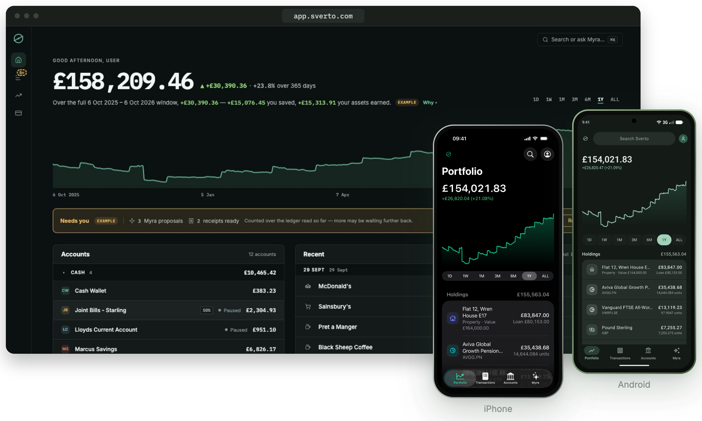
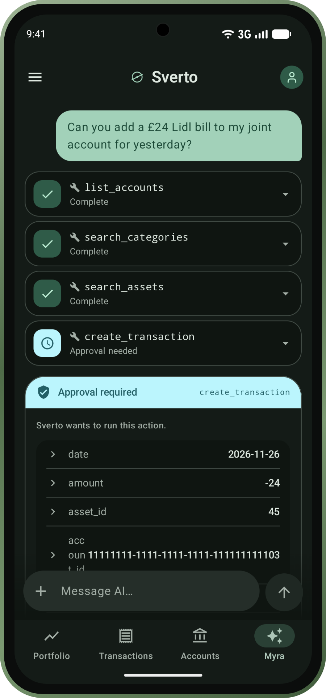
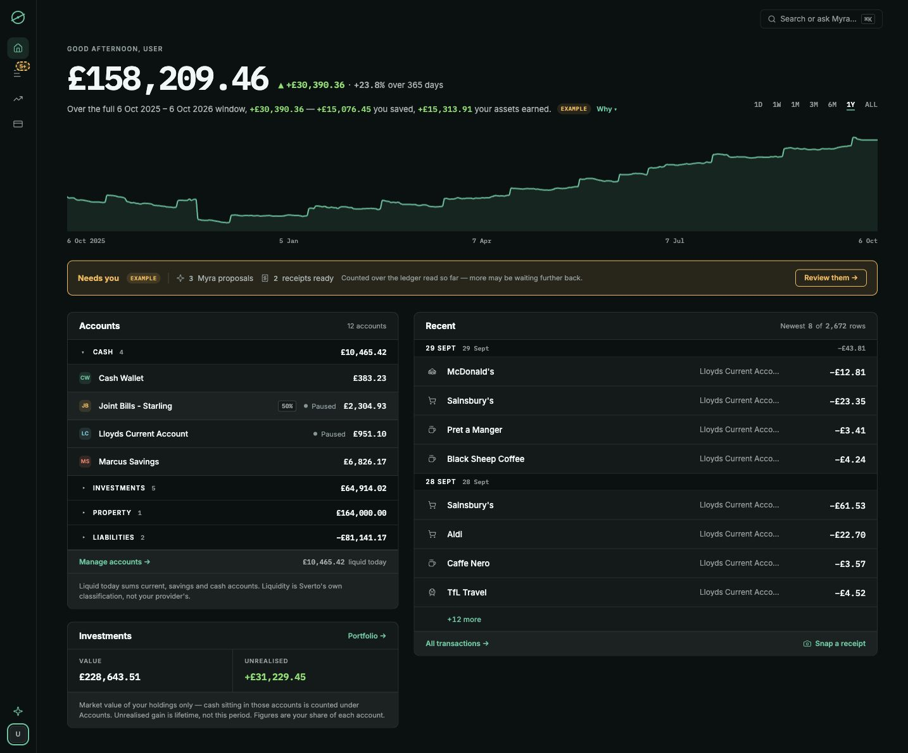
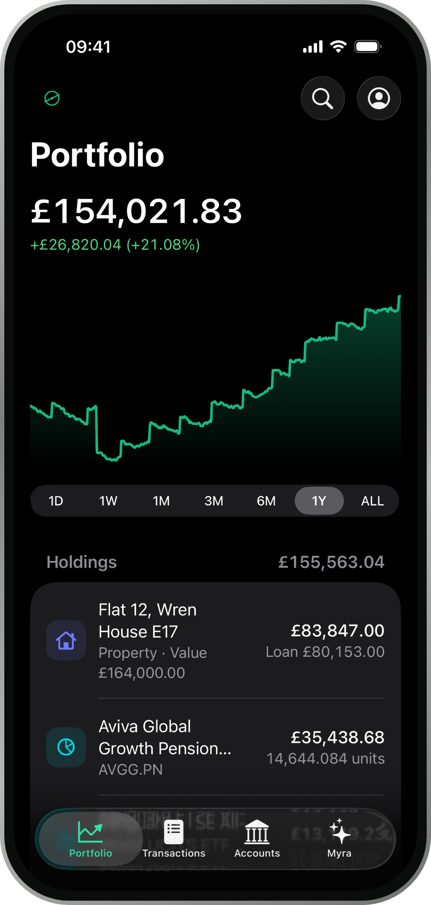
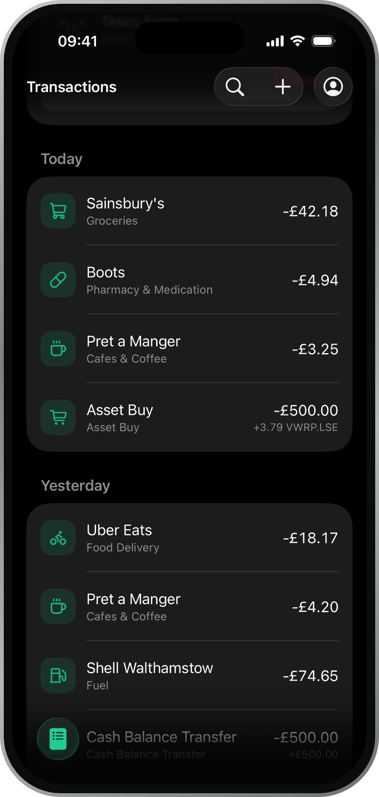
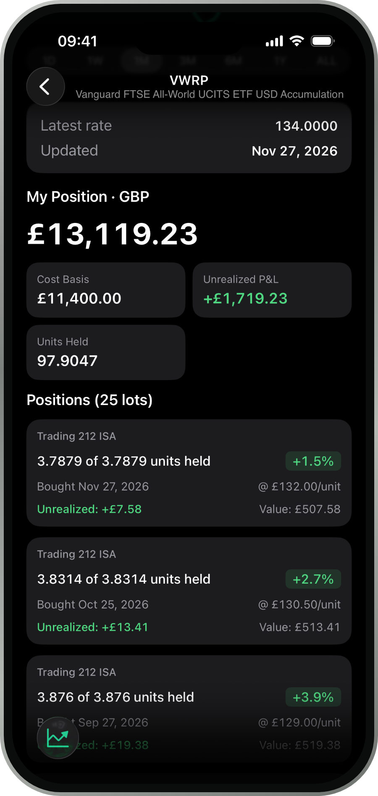
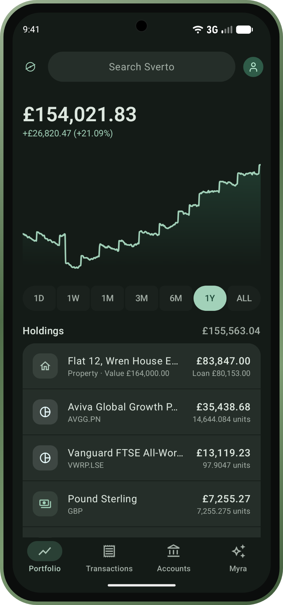
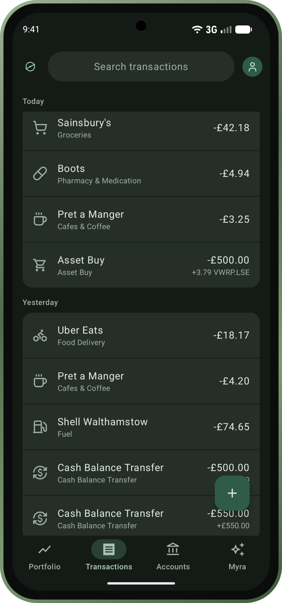
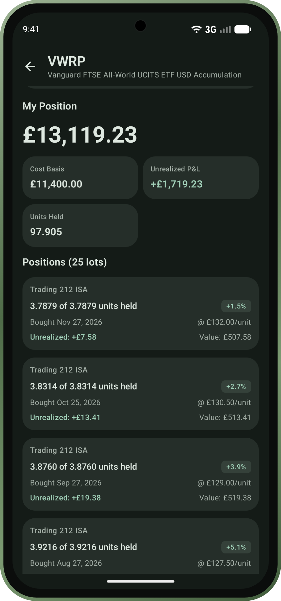

  

<h1 align="center">Sverto</h1>

  <strong>The open source personal finance app that puts you in control.</strong> 
  Track your entire financial life — spending, investments, and net worth — all in one place. 
  <a href="https://sverto.com"><strong>Try it at sverto.com</strong></a>

  
  &nbsp;
  

  
  
  

  

---

## Your finances, your way

Most finance apps force you into a box. Investment trackers ignore your daily spending. Budgeting apps can't handle your portfolio. You end up juggling three different tools, manually reconciling numbers, and never seeing the full picture.

**Sverto is different.** It's the only open source app that tracks everything in one unified view:

- **Daily spending** — every purchase, subscription, and bill
- **Investment portfolio** — stocks, ETFs, crypto, commodities
- **Net worth** — real-time and historical, across all your accounts

No vendor lock-in. No data mining. Your financial data stays on your machine.

---

## What you can do with Sverto

### Track everything

Record purchases, sales, dividends, transfers, and fees — from your morning coffee to an ETF dividend reinvestment.

### See your full financial picture

A real-time net worth chart across all accounts. Drill down by time range — last 24 hours, last month, or your entire history.

### Manage your investment portfolio

See every holding across every account. Track cost basis, unrealized and realized gains, dividends, and fees. Drill into individual positions.

### Ask your finances anything

Sverto comes with **Myra**, a built-in AI assistant that understands your data — ask questions in plain English or have it draft transactions for you. [More on Myra below.](#myra--ai-that-works-for-you)

### Organize your way

Create custom categories, manage multiple accounts (bank, brokerage, wallet, joint), and track assets with real-time market rates.

---

## Myra — AI that works for you

The AI assistant has full context of your financial data through a set of tools:

- **Semantic search** — find transactions by meaning, not just keywords
- **Aggregation** — ask "what did I spend by category?" and get real answers
- **Transaction creation** — the AI can draft transactions for your approval
- **Portfolio questions** — inquire about holdings, gains, and asset performance

The AI assistant uses Gemini and stores embeddings in your PostgreSQL database. When self-hosting, you'll need your own Gemini API key. Hosted users get AI and market data included.

> *Example: "Can you add a £24 Lidl bill to my joint account for yesterday?"*

  

---

## Available everywhere

- **[Web](https://app.sverto.com)** — Full-featured web app. Run it on your own server or access it from any browser.
- **[Android](https://play.google.com/store/apps/details?id=com.sverto.app)** — Native Kotlin app with Jetpack Compose, powered by the shared Rust core.
- **[iOS](https://apps.apple.com/app/sverto/id6819424663)** — Native SwiftUI app, powered by the shared Rust core.

### Web

Net worth, accounts, and recent activity in one view.

  

  
Explore transactions and investments on the web

  

    
  

  

    
  

### iOS

Portfolio history, everyday transactions, and individual purchase lots in the native iOS app.

  
  
  

### Android

  
  
  

Screens show demo data. iOS and Android screenshots are generated by `make store-shots`; web screenshots captured in October 2026.

---

## Powered by modern technology

  
  
  
  
  
  
  

The backend is written in Rust for speed and reliability. The web frontend uses React with TypeScript. Android uses Kotlin + Jetpack Compose, and iOS uses SwiftUI. Both native apps share the Rust core through UniFFI.

---

## Why open source matters for your finances

- **Your data stays yours.** Self-host and your financial data never leaves your server.
- **No subscriptions.** No monthly fees, no premium tiers. All features are free.
- **Transparent and auditable.** Every line of code is public — you can verify exactly what happens with your data.
- **Free for everyone.** AGPLv3 licensed — download it, run it, modify it however you want.
- **Community-driven roadmap.** Features are built based on what users actually need, not what maximizes revenue.

---

## Want the easy way?

Running open source software yourself can be rewarding, but it comes with friction — especially when you need market data feeds and AI API keys. **[sverto.com](https://sverto.com)** is the managed version of Sverto, with everything handled for you: automatic updates, live market data, and AI integration built in.

No setup. No API keys to manage. And every subscription directly supports Sverto's development.

The app collects only the telemetry needed to keep the service fast and reliable — error traces and performance metrics, nothing more. The website counts visits with cookie-free [Plausible](https://plausible.io/sverto.com), and the stats are public. Your financial data is never sold, shared, or mined for advertising.

→ [**Try it at sverto.com**](https://sverto.com)

---

→ [**Star on GitHub**][stars] &nbsp;|&nbsp; → [**Report an issue**][issues] &nbsp;|&nbsp; → [**Contribute**][pulls]

[stars]: https://github.com/EinarasGar/sverto/stargazers
[issues]: https://github.com/EinarasGar/sverto/issues
[pulls]: https://github.com/EinarasGar/sverto/pulls
